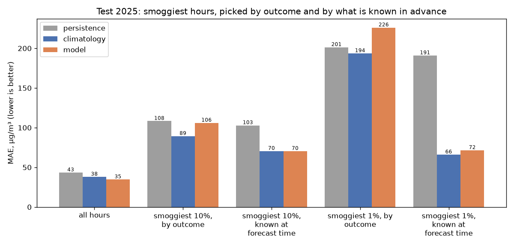
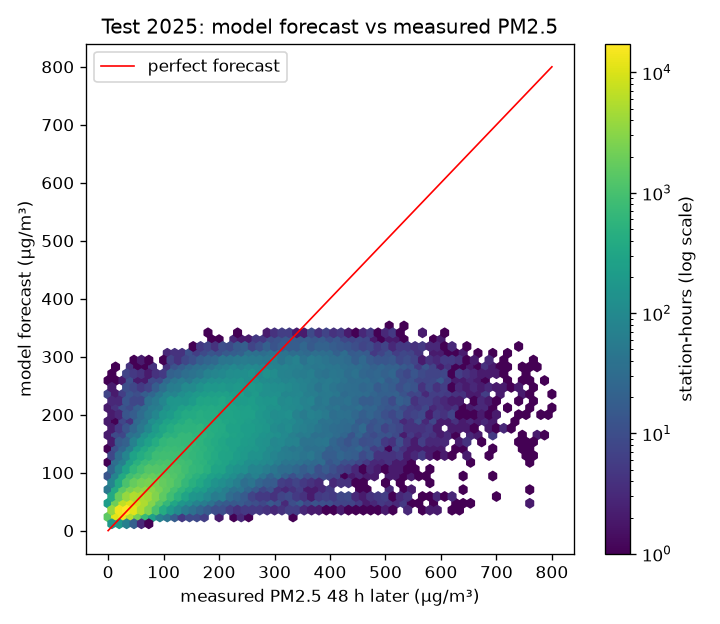
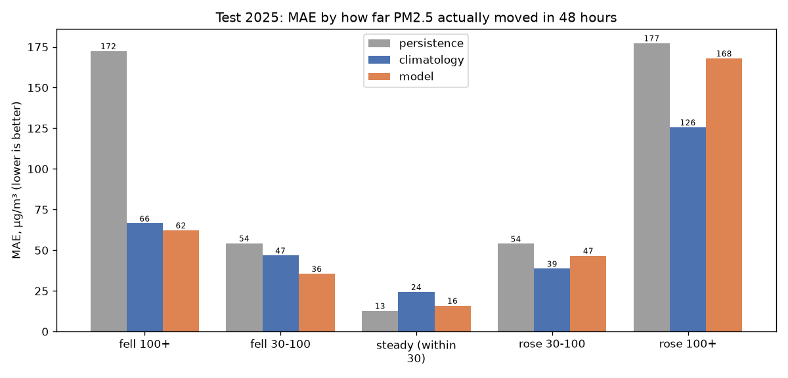
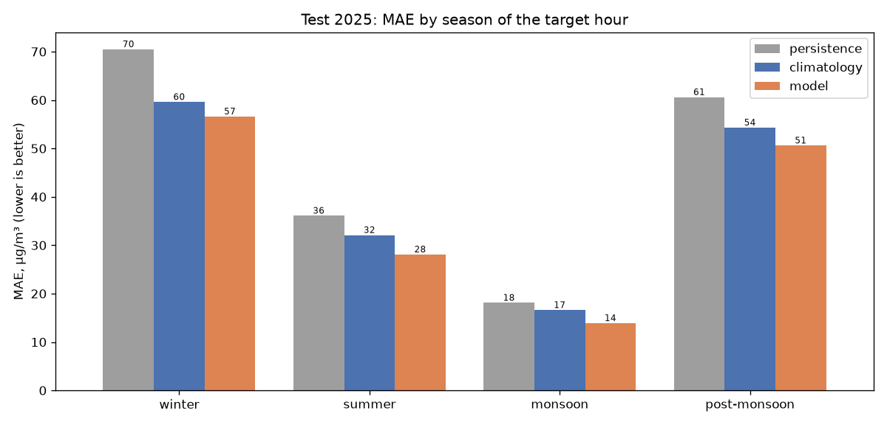
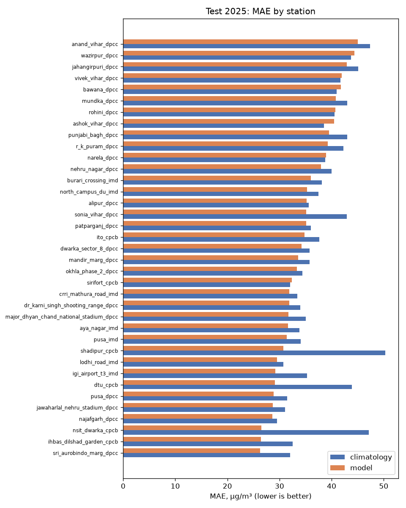
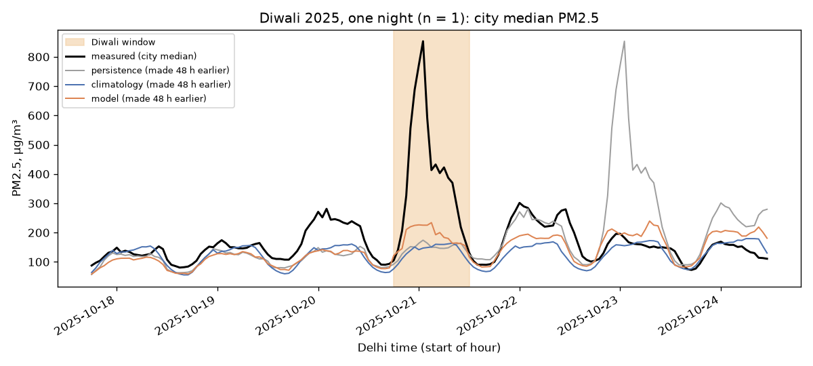
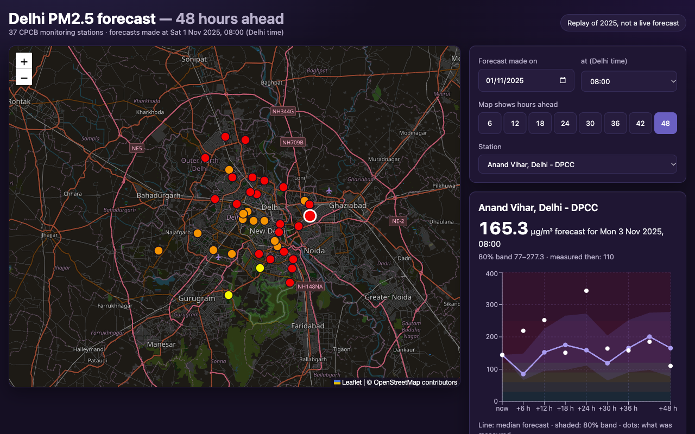

# Delhi PM2.5 forecast — 48 hours ahead, per monitoring station

**Live site: https://delhi-pm25.onrender.com** — a replay of the 2025 test year. It runs on
Render's free plan: after 15 quiet minutes it sleeps, and the next visit takes about a minute
to wake it.

Forecasts **hourly PM2.5** (fine particulate matter, in µg/m³) up to 48 hours ahead for
37 of Delhi's 39 continuous air-quality monitoring stations, using three years of CPCB
station data (2023–2025) and Open-Meteo weather.

> **Status (21 Nov 2026): all 7 stages done — the website is live (a replay of 2025). Planned follow-ups are listed under Progress.**
> The model beats both baselines on average but not in the smoggiest hours (see Results).
> The two things a reader should know before any result appears — the missing-data
> problem and which stations were dropped — are written down now, before modelling.

## What this project forecasts (and what it does not)

- **It forecasts PM2.5 concentration, not AQI.** India's AQI is a 0–500 index built from
  24-hour averages of up to seven pollutants, reporting the worst one. This project
  predicts one pollutant, hour by hour, in µg/m³.
- The map will colour stations with CPCB's PM2.5 bands (Good 0–30, Satisfactory 31–60,
  Moderate 61–90, Poor 91–120, Very Poor 121–250, Severe above 250 µg/m³). CPCB defines
  these bands for 24-hour averages, so the map labels them **"PM2.5-based category"** and
  never calls them AQI.
- Why PM2.5: particulate matter (PM2.5 or PM10) decides Delhi's AQI in 92.6% of the hours
  where an AQI can be computed, and the AQI stops at 500 (Anand Vihar sits at the cap in
  10.2% of those hours), so it cannot tell "very bad" from "catastrophic".
- The whole pipeline can be re-run with PM10 as the target by changing one line in
  `config/pipeline.toml`.

## The most important limitation: the worst readings are often missing

Monitors drop out more often exactly when pollution is extreme, so the hardest hours are
the ones we can least measure. Statisticians call this data *missing not at random*.

How often the **next** 15-minute reading is blank, by the level of the current reading
(all 39 stations, 2023–2025; `reports/stage2/missing_after_high_readings.csv`):

| Current reading (µg/m³)   | below 300 | 300–600 | 600–800 | 800–900 | 900–950 | 950 or more |
|---------------------------|-----------|---------|---------|---------|---------|-------------|
| PM2.5: next reading blank | 1.8%      | 2.2%    | 2.9%    | 6.3%    | 10.3%   | **19.3%**   |
| PM10: next reading blank  | 1.2%      | 1.1%    | 1.8%    | 3.9%    | 6.0%    | **8.3%**    |

The analysers stop at 1000 µg/m³, and readings near that limit are often deleted instead
of published.

Blank hourly PM2.5 values in the test period (calendar 2025), in all hours and in the
smoggiest hours. An hour's smog level is the median across the stations that did report,
so an hour still counts as smoggy when its worst readings are missing
(37 kept stations, after cleaning; `reports/stage2/missing_in_worst_hours.csv`):

| Test hours (2025) | Hours | City median at least | PM2.5 blank (cannot be scored) | Built from only 1–3 of 4 readings |
|-------------------|-------|----------------------|--------------------------------|-----------------------------------|
| All hours         | 8,760 | —                    | 4.6%                           | 6.3%                              |
| Smoggiest 10%     | 879   | 223 µg/m³            | **3.1%**                       | 6.1%                              |
| Smoggiest 1%      | 88    | 379 µg/m³            | **8.7%**                       | 7.1%                              |
| Smoggiest 0.1%    | 9     | 488 µg/m³            | **27.3%**                      | 10.5%                             |

How to read this:

- The smoggiest 10% of hours are ordinary winter smog, and the monitors work about as well
  then as at any other time (3.1% blank, against 4.6% overall, which long outages in clean
  months push up). A single "top 10%" number would make the problem look solved.
- The problem sits in the extreme tail: 8.7% of values are missing in the worst 1% of hours,
  and more than a quarter in the worst 0.1% (only 9 hours, so that figure is rough).
- An hourly value built from fewer than four readings comes out too low when the missing
  readings were the highest ones.

What this means for the results:

- Every error number in this project is computed on hours that *were* measured. It
  understates the error in the most dangerous hours, and the model sees few extreme values
  to learn from.
- No missing PM2.5 value is ever filled in: we do not invent the numbers we score against.
- Hours where an analyser hit its 1000 µg/m³ limit carry a flag (`pm25_at_ceiling`).
- The error on the smoggiest 10% and 1% of test hours is a **headline result**, reported
  next to the overall error together with the share of those hours that cannot be scored.
- The city-wide median (a feature) is taken over the stations that reported, so in heavy
  smog it rests on fewer stations and may come out too low. A feature counts those
  stations (`city_pm25_n_stations`). Over training hours it averages 35.0 of 37 stations,
  36.0 in the smoggiest 10%, 34.7 in the smoggiest 1% and 33.6 in the smoggiest 0.1%
  (minimum 22): `reports/stage3/city_median_stations.csv`.

## Results

Mean absolute error (MAE, average size of the miss in µg/m³; lower is better) of the
48-hour-ahead PM2.5 forecast on the test period, calendar 2025 (Delhi time). Two baselines:
persistence, "PM2.5 in 48 hours = PM2.5 now", and climatology, "PM2.5 in 48 hours = the
training-period average for this station at the same Delhi clock hour, on days within 7
either side of the same calendar day" (at least 5 values, else blank). MAE = mean absolute
error in µg/m³. Every method is scored on the same rows: target measured and both baselines
available (298,602 of the 309,066 measured test rows; the rest have no reading "now" or too
little history). The model will be scored on these same rows.

| Test hours    | Cannot be scored (blank) | Persistence MAE       | Climatology MAE       | Model MAE             |
|---------------|--------------------------|-----------------------|-----------------------|-----------------------|
| All hours     | 4.6%                     | 43.4                  | 38.0                  | **34.7**              |
| Smoggiest 10% | 3.1%                     | 108.3                 | **89.3**              | 106.0                 |
| Smoggiest 1%  | 8.7%                     | 201.3                 | **193.6**             | 226.1                 |

Validation fold (train on 2023, score 2024), used while building the model: persistence 47.1 / climatology 43.3 on all hours, 119.3 / 110.5 on the smoggiest 10%, 263.8 / 297.1 on the smoggiest 1% (`reports/stage4/baselines.csv`). Climatology is the stronger baseline overall, but in the smoggiest 1% of 2024 hours persistence wins: extreme episodes don't repeat on the same calendar days.

**How to read the model column.** The model (LightGBM, stage 5) is better than both
baselines on average: 34.7 vs 38.0 for climatology (−8.6%) and 43.4 for persistence (−20%).
It is **not** better in the hours that matter most: in the smoggiest 10% of 2025 hours it is
worse than climatology (106.0 vs 89.3), and in the smoggiest 1% it is the worst of the three.
Reasons (checked in stage 6, below): the model forecasts the typical (median) outcome,
which is right for MAE overall but pulls forecasts down in rare smog; ranking hours by how
smoggy they *turned out* favours forecasts that never pull back towards typical values (the
"forecaster's dilemma"); and two winters are little to learn extremes from. The model also
forecasts rows where "PM2.5 now" is blank, which persistence cannot: MAE 34.6 on all 309,066
measured test rows.

The test year was scored twice, and both results are reported. The first run used every
feature (34.4 on all hours; 105.0 and 236.1 on the smoggiest 10% and 1%). Checks on the
validation year alone then found a flaw in the feature comparison and showed that
day-of-year features hurt (see "Model (stage 5)"). The corrected model was chosen on 2024
and scored on 2025 a second time (the table). The two runs differ by 0.3 µg/m³ on all hours.

Where the model is weak (winter vs summer, spikes vs steady periods, station by station)
will be reported in stage 6. Diwali 2025 is reported there separately and labelled n = 1:
one night, where a good result is luck as much as skill.

## Weather: what the model may know, and two planned comparisons

- **Chosen (2 Oct 2026): only weather known when the forecast is made.** Features use
  Open-Meteo's archive of the ECMWF IFS weather model for hour *t* and earlier, never the
  actual weather at *t* + 48 h. The same features exist for all three years.
- **Archived 2-day weather forecasts exist only from about 20 January 2024**, so the main
  pipeline does not use them: 2023 rows would be structurally different from 2024–2025.
- **Boundary-layer height (BLH) was built as a feature, with a known hole; stage 5 dropped it.** BLH is the depth of air that
  pollution mixes into (median about 45 m on winter nights vs about 1,900 m on summer
  afternoons in ERA5), so the physical reason to use it is strong. ERA5 has no BLH for
  January–June 2024 (about 25% of training hours); those rows have it blank.

> **Warning: training/serving mismatch for BLH.** Training BLH comes from ERA5, a
> reanalysis published about five days late. The live service in stage 7 must take BLH
> from a different, real-time model. If the two disagree, BLH can look useful in the
> backtest and still hurt live forecasts. Stage 7 compares the two sources over the same
> days before BLH is used live.

Planned comparisons (results go here, whichever way they come out):

| Question | How | Rule |
|---|---|---|
| Does BLH earn its place? | Stage 5: the same model, same number of trees, with and without the BLH features | **No:** removing them changed validation MAE by −0.15% (all hours) and −0.67% (smoggiest 10%), so BLH is dropped and the mismatch warning above no longer applies |
| Does knowing the weather forecast help predict PM2.5 two days out? | After the main pipeline works: a 2024–2025-only variant (train 2024, test 2025) with and without the archived 2-day ICON forecasts, compared at 48 h | Reported here either way |
| Does the stubble-season flag add anything? | Stage 5: with and without `target_in_stubble_season` (15 Oct–15 Nov) | **No:** −0.22% / +0.02% on validation, so it is dropped |

## Stations: the selection rule was fixed before any model

Rule, set on 2 Oct 2026 in `config/pipeline.toml` before any model was trained: keep a
station only if it reported PM2.5 in at least **75% of its 15-minute slots during the
training period** (2023–2024, Delhi time). Test-period coverage is shown below but is not
used by the rule.

| Station                       | Training coverage | Test coverage (not used) | Result      |
|-------------------------------|-------------------|--------------------------|-------------|
| Chandni Chowk (IITM)          | 29.3%             | 73.1%                    | **dropped** |
| Lodhi Road (IITM)             | 35.0%             | 76.3%                    | **dropped** |
| Sirifort (CPCB), lowest kept  | 79.1%             | 95.7%                    | kept        |

- 37 of 39 stations are kept. Judged on test data instead, Lodhi Road (IITM) would have
  passed and Chandni Chowk nearly so; the rule deliberately looks only at training data.
- The result does not hinge on the split date: with the test period starting 1 Jul 2025
  the same two stations are dropped; starting it 1 Jul 2024 would also drop Sirifort
  (73.5%). To check, change `test_start` and re-run `scripts/05_clean.py`.
- Full table, with coverage per year: `reports/stage2/station_selection.csv`.

## Rules that keep the evaluation honest

- **Time-based split, never shuffled:** train on 2023–2024, test on calendar 2025 (Delhi
  time), set once in `config/pipeline.toml`.
- Every decision that looks at the data (station selection, thresholds) uses training
  data only.
- A forecast made at hour *t* may only use what is known at *t*: each hourly value counts
  from the end of its hour, and the actual weather at *t* + 48 h is never used.
- Two cleaning rules (spikes, frozen readings) look at the following hours, so in live use
  they cannot be applied in exactly the same way to the newest hours. This is a small,
  known difference between the test setup and live forecasts.
- A 48-hour gap before every boundary: training rows are forecasts made at least 48 hours
  before it, so no training target lies past it. `src/delhi_pm25/split.py` stops with an
  `EmbargoError` if any training row's target hour starts on or after the boundary, and
  `tests/test_split.py` checks both folds.
- Model choices (features, settings) are made on a validation fold: train on 2023, score
  2024. It has only one winter to learn from, less than the final model, which trains on
  2023–2024 and meets 2025 once.
- The horizon stays at 48 hours. A small honest gain over the baselines is reported as it
  is; the horizon is never shortened to make the gain look bigger.

## Cleaning decisions (stage 2)

Every choice lives in `config/pipeline.toml`; the evidence is in `reports/stage2/`.

| #    | Question | Decision | Why |
|------|----------|----------|-----|
| D0   | What to forecast | Hourly PM2.5 (µg/m³) | See "What this project forecasts". |
| D1   | Timestamps | Labels are Delhi time (IST) wrongly marked `+0000`; converted once to true UTC (label − 5 h 30 min). Each hourly value is stamped with the **end** of its hour, the moment it is known. | Solar radiation peaks at label 11:15–13:15 at all 30 stations with a sun sensor (solar noon is 12:20 IST = 06:50 UTC); station temperature matches Open-Meteo best after a 5–5.5 h shift at all 26 stations with a thermometer; stations without sensors line up with sun-checked neighbours within ±1 h; an independent OpenAQ copy with explicit `+05:30` matches 83 of 83 readings at zero shift. |
| D2   | 15-minute → hourly | Mean of the readings present (at least 1 of 4); the count is stored (`n_pm25`) | Demanding all four would blank another 6.9% of station-hours, and about half the hours at Jahangirpuri and Rohini, where one slot is routinely missing. |
| D3   | Missing values | Left blank; the target is never filled | Interpolation uses the next real reading (future information) and would draw a straight line under deleted peaks. |
| D3   | Stations | Keep if ≥ 75% coverage in training | See "Stations" above. |
| D4.1 | One-hour spikes (up more than 200 µg/m³ and straight back down) | Rule (d): removed when the city median that hour is below 200 µg/m³, kept when it is 300 or more, and in between removed only if the spike is at least 2× its higher neighbouring hour. 111 removed (107 in a calm city, 4 glitch-sized), 42 kept (27 in a polluted city, 15 under 2×) | On calm days they are glitches (DTU, 4 Mar 2024: 24 → 1000 → 15). On polluted nights they can be real (Sonia Vihar, Diwali night 2025: 514 → 923 → 713, city median 853). Why (d): it keeps Nehru Nagar on 3 Jan 2025 and Patparganj on Diwali night 2024 (both under 2× their higher neighbour) but still removes the Burari glitch of 6 Aug 2024 (city median 15), which the 2× test alone would have kept. |
| D4.2 | Frozen readings | Values unchanged for 6 hours or more are blanked: PM2.5 54 stretches (1,233 h), PM10 39 (718 h). Hours where the analyser hit its 1000 µg/m³ limit are exempt and keep their "hit the limit" flag (DTU PM10 sat at exactly 1000 for 49 h in Jan 2023 and 8 h in Jun 2024) | A stuck analyser (longest: Narela, 153 hours at exactly 53.0 µg/m³ in June 2023). A value pinned at the limit may be real smog above it, so it is flagged, not deleted. |
| D4.3 | PM2.5 above PM10 (physically odd) | Kept | Rare: a median of 0% of hours per station. |
| D4.4 | Station weather sensors | Not used; weather comes from Open-Meteo | 13 of the 39 stations have no thermometer; the "BP (mmHg)" column holds hPa at 24 stations, mmHg at 4 and nothing at 11. |
| D5   | Station identity | CPCB station ID (e.g. `site_124`), not the name | Names drift (trailing spaces, different titles), and Lodhi Road IITM and Lodhi Road IMD are different stations 0.67 km apart (PM2.5 correlation 0.57). |
| D6   | Time grid | One row per station per hour, blank if no data; a check stops the run otherwise | Without it, "the value 24 rows earlier" silently stops meaning "24 hours earlier". |
| —    | Textbook outlier rule (IQR) | Rejected | It would delete 5.5% of hours, 93.8% of them in October–January: exactly the season we must forecast. |

Also not carried past cleaning: NO and NOx (they overlap with NO2) and benzene, toluene and
xylene (mostly empty).

## Features (stage 3)

A forecast is made at hour *t* (the end of the latest complete hour) for the hour ending
*t* + 48 h. Each row holds only what is known at *t*, plus the calendar of the hour being
forecast. Settings: `[features]` in `config/pipeline.toml`; every feature with its reason:
`reports/stage3/feature_list.csv` (42 features).

| Group | Features | Why |
|---|---|---|
| Station | station ID | Local sources make some stations run higher |
| A own history | PM2.5 now and 3, 6, 12, 24, 48, 168 h ago | Pollution persists; 24 and 48 h ago share the target's time of day |
| B rolling means | means of the last 6, 24, 72, 168 h (blank unless half the hours have a value) | The level of the current episode, steadier than one hour |
| C city-wide | city median now, its 24 h mean, stations behind it, station minus city | Delhi's pollution is regional; still works when this analyser is down |
| D calendar | hour of day and day of year of the target hour (as sine and cosine) | Daily cycle and season |
| E events | Diwali window (18:00 on Diwali to 12:00 next day), stubble season (15 Oct–15 Nov) | Known pollution events; only two Diwalis in training |
| F weather now | temperature, humidity, dew point, pressure, cloud, sunshine, wind (speed, east–west and north–south parts, 24 h mean), rain in the last 24 h, BLH now and its 24 h minimum, BLH × wind | Weather decides how fast pollution spreads out or washes out |
| G other | PM10, NO2, CO now; readings in the current hour, hours since the last reading, analyser hit its limit in the last 24 h | Source hints and data-quality signals |

Spearman correlation with the PM2.5 value 48 h later, training rows only
(`reports/stage3/feature_correlations.csv`): PM2.5 now 0.752, 24 h ago 0.725, mean of the
last week 0.744, city median now 0.730. No feature is dropped on these numbers, because a
feature can matter in combination with others; pruning waits for the stage 5 importances.
`pm25_minus_city` correlates only 0.146 with the target because the target's level is set
mostly by city-wide smog and the season; the same gap now and 48 hours later correlates
about 0.48 (checked separately), so a station that runs above the city tends to stay there.

`tests/test_leakage.py` checks for leakage automatically: it changes every input after a
cut-off hour and checks that no feature at or before that hour moves, for every feature
column, including any added later.

## Model (stage 5)

LightGBM gradient-boosted trees: small decision trees grown one after another, each
correcting the errors of the ones before. Settings are in `[model]` of `config/pipeline.toml`,
committed before the first model was trained:

- Objective "l1": the model minimises mean absolute error, the metric reported here.
- Every other LightGBM setting is its default; nothing was tuned. The number of trees is the
  one value taken from data: training on 2023 stops when 100 more trees no longer improve the
  2024 score. It stopped early (36 trees with every feature, 51 for the final set), a sign
  that 2023 and 2024 differ and that extra trees only learn 2023's quirks.
- Feature groups are tested on the validation fold by removing them. A group stays only if
  removing it makes MAE worse by at least 1% on all hours or on the smoggiest 10%.

| Removed from the model | Validation MAE change, all hours | Smoggiest 10% | Decision |
|---|---|---|---|
| BLH (`wx_blh`, `wx_blh_min_24h`, `wx_ventilation`) | −0.15% | −0.67% | dropped |
| Stubble-season flag | −0.22% | +0.02% | dropped |
| Day of year (`target_doy_sin`, `target_doy_cos`) | −4.11% | −10.59% | dropped |

Two corrections were made after the first run; both are in the git history. The first
comparison let each variant pick its own number of trees (26 vs 36), which mixed tree count
with features, so every variant now gets the same number. The day-of-year group was added
after a validation-only check showed that, with one training year, the trees memorised that
year's calendar. All these decisions use 2024 only, never 2025. With two training years the
test year barely changed, so the one-winter validation fold exaggerates such effects.

The final model relies most on PM2.5 now (32.5% of the total gain), the city median now
(21.1%), PM2.5 24 hours earlier (7.7%), the 72-hour mean (6.4%) and air pressure (5.1%)
(`reports/stage5/importance.csv`).

## Error analysis (stage 6): where the model is weakest

All numbers are for the test year 2025. The three forecasts are compared on the same rows.
MAE is in µg/m³; bias is the average of forecast minus truth (negative means the forecasts
were too low). Tables and charts are in `reports/stage6/`. Nothing here was used to change
the model.

**The smoggiest hours (headline).**

| Hours | Persistence | Climatology | Model | Model bias | Target blank |
|---|---|---|---|---|---|
| All hours | 43.4 | 38.0 | **34.7** | −9.8 | 4.6% |
| Smoggiest 10%, by outcome | 108.3 | **89.3** | 106.0 | −95.6 | 3.1% |
| Smoggiest 1%, by outcome | 201.3 | **193.6** | 226.1 | −222.4 | 8.7% |
| Smoggiest 10%, known at forecast time | 102.9 | 70.5 | **70.4** | −21.8 | 2.9% |
| Smoggiest 1%, known at forecast time | 190.9 | **66.0** | 71.5 | −3.2 | 2.7% |

These rows answer two different questions. "When it turned out smoggy, how wrong were we?"
(by outcome): every method under-forecasts badly and the model most, because it leans
towards typical values. Its forecasts level off around 300–350 µg/m³ however high the real
value goes (`forecast_vs_measured.png`). "When the city is smoggy now, how good is the
48-hour forecast?" (hours chosen by the city median at forecast time, which is fair to every
method): the model ties climatology and beats persistence by about a third, because heavy
smog usually clears within two days (persistence's bias there is +56). A smog warning is
judged by the first question, so it stays the headline: **the model is not yet useful for
warning of the worst smog two days ahead.**

**Season.** The model beats both baselines in every season, but its winter MAE is four times
its monsoon MAE (56.6 vs 13.9), and its low bias is largest in October–November (−20.8) and
winter (−15.8).

**Steady periods vs sharp changes**, split by how far PM2.5 actually moved in the 48 hours.
When it stayed within 30 µg/m³, persistence is best (12.8 vs the model's 16.0). After falls
the model is best (62.3 vs 66.5 for climatology after falls of 100+). **When PM2.5 rose by
more than 100 µg/m³, the model is almost as bad as persistence** (168.0 vs 177.4; climatology
125.6): it does not see sudden smog build-ups coming two days ahead. Forecast weather is the
most promising fix, and the planned forecast-weather comparison tests exactly that.

**Stations.** The model beats climatology at 30 of 37 stations (median gain 5.5%) and is
slightly worse at seven: Ashok Vihar (−5.2%), Bawana (−2.0%), Wazirpur (−1.6%), Sirifort
(−1.2%), Vivek Vihar (−0.5%), Narela (−0.3%), Rohini (−0.2%). The largest errors are at the
dirtiest stations (Anand Vihar 45.0, Wazirpur 44.4, Jahangirpuri 42.9). NSIT Dwarka gains
44% because its 2025 levels sit well below its 2023–2024 average, which misleads
climatology (bias +36.9), while the model follows recent readings.

**Diwali 2025 (one night, n = 1).** All three forecasts missed the spike by about 200 µg/m³
(model MAE 206.8, bias −196.8; climatology 237.9; persistence 228.6). With only two Diwalis in
training, the Diwali flag cannot teach the model the size of the spike. One night is an
anecdote, not evidence.








## Serving (stage 7)

The website starts as a **replay of the test year 2025**: pick a date and time, and see what
the model would have forecast then for the next 48 hours, next to what was measured. A replay
needs no API keys and no live data; live forecasts come later.

Step 1 (done): one model per horizon, every 6 hours up to 48 hours ahead, each with an
uncertainty band from two quantile models (the 10th and 90th percentiles, so about 80% of
measured values should fall inside). Test year 2025, from `reports/stage7/horizons.csv`:

| Hours ahead | Persistence MAE | Climatology MAE | Model MAE | Inside the 80% band | Inside the band, smoggiest 10% |
|---|---|---|---|---|---|
| 6 | 42.1 | 37.8 | **27.0** | 78.4% | 71.2% |
| 12 | 50.1 | 37.9 | **30.2** | 79.6% | 66.9% |
| 24 | 37.2 | 37.9 | **31.6** | 79.5% | 63.7% |
| 36 | 54.9 | 37.9 | **34.7** | 79.0% | 59.4% |
| 48 | 43.4 | 38.0 | **34.7** | 79.0% | 59.3% |

The model beats both baselines at every horizon. The band holds what it promises on average
(78–81% at every horizon) but is too narrow in heavy smog (59–71%), the weakness found in
stage 6. Persistence does well at 24 and 48 hours (the same clock time as now) and badly at
12 and 36 (the opposite part of the daily cycle). Map colours use CPCB's PM2.5 bands, which
CPCB defines on 24-hour averages; applying them to an hourly forecast is an approximation, so
the map says "PM2.5-based category", never AQI.

Step 2 (done): a FastAPI backend serving `serving/replay_2025.parquet` (726 issue times,
08:00 and 20:00 Delhi time from 1 January to 29 December 2025, for 37 stations):

```
.venv/bin/uvicorn delhi_pm25.server:app --reload    # then open http://127.0.0.1:8000/docs
```

| Endpoint | Returns |
|---|---|
| `GET /api/meta` | issue times, horizons, stations, colour bands, credits |
| `GET /api/map?issued=…&horizon=48` | every station's forecast for one horizon, with its PM2.5-based category |
| `GET /api/stations/{slug}/forecast?issued=…` | one station's path from now to 48 h: band, median, what was measured |

Step 3 (done): the website (`frontend/`, React + TypeScript + Vite; Leaflet map on
OpenStreetMap tiles; Recharts). Pick when a forecast was made (any day of 2025, 08:00 or
20:00 Delhi time) and how many hours ahead the map shows; click a station or pick it from the
list to see its 48-hour path: the median forecast, the 80% band fanning out from the value
measured at that moment, and what was later measured. Colours are labelled "PM2.5-based
category" everywhere, and the footer credits the data sources. The design system is in
`frontend/DESIGN.md`; the layout was checked in a real browser at 375, 768 and 1280 px wide.



Step 4 (done): one Docker image holds the website and the API. It builds the React
site, then serves it with FastAPI as a non-root user, on the port the host provides (`$PORT`,
default 8000):

```
docker build -t delhi-pm25 .
docker run --rm -p 8000:8000 delhi-pm25     # then open http://localhost:8000
```

The image carries `serving/replay_2025.parquet` (4.4 MB). Its measured values are derived from
CPCB data, so that file is published under ODbL-1.0 with credits (`serving/LICENSE-DATA.md`).
It is deployed on Render's free plan from `render.yaml` (Singapore region):
https://delhi-pm25.onrender.com. Railway's free plan (`railway.json`) works too and can
deploy without GitHub.

## Quirks in the source data (handled in cleaning)

- Timestamps are Delhi time but marked `+0000` (UTC): the upstream parser labels local time
  as UTC without shifting it. Joining them to weather as if they were UTC would misalign
  everything by 5.5 hours.
- The upstream compiler deletes rows in which every column is empty, so three stations
  (ITO, NSIT Dwarka, Shadipur) have fewer rows; the hourly grid turns these into explicit
  blanks.
- Most DPCC stations publish hourly values repeated in all four 15-minute slots; IMD
  stations report genuine 15-minute values.
- Analysers top out at 1000 µg/m³. Some stations publish 1000, others leave the reading
  blank (see the limitation above).

## Data and credits

| What | Source | Licence |
|------|--------|---------|
| PM2.5, PM10 and gases, 15-minute, 39 stations, 2023 | CPCB data repository, compiled by [Vonter/india-cpcb-aqi](https://github.com/Vonter/india-cpcb-aqi) (release `2023`) | ODbL-1.0 |
| The same, 2024–2025 | CPCB data repository, republished by [OpenCity](https://data.opencity.in/) as "Delhi Hourly Air Quality Reports" | treated as ODbL-1.0 (copies of the Vonter files) |
| Weather: ECMWF IFS actuals, ERA5 boundary-layer height, archived DWD ICON forecasts | [Open-Meteo](https://open-meteo.com/) Historical Weather and Previous Runs APIs (free, non-commercial) | CC BY 4.0 |
| Station coordinates | CPCB's real-time air-quality feed on data.gov.in | Government Open Data License – India |

- Air-quality data: **Central Pollution Control Board (CPCB)**, Government of India,
  continuous monitoring stations operated by CPCB, DPCC, IMD and IITM.
- The two copies agree: R K Puram 2024 is identical value for value in Vonter's release and
  OpenCity's file (631,295 values), and all 39 stations have identical row counts.
- The station data is licensed under ODbL-1.0. Raw and cleaned data are **not** committed
  here (the scripts download them), and any derived database shared publicly must carry
  the same licence. The map footer (stage 7) credits CPCB, Vonter/india-cpcb-aqi, OpenCity
  and Open-Meteo.
- Older years exist upstream (back to 2009) but are not used here.

## Reproduce

Python 3.14; versions pinned in `requirements.txt`. About 1.2 GB of downloads.

```bash
python3 -m venv .venv
.venv/bin/pip install -r requirements.txt

.venv/bin/python scripts/01_fetch_cpcb.py                      # 2024–2025 station files (~460 MB)
.venv/bin/python scripts/01b_fetch_cpcb_vonter.py --year 2023  # 2023 (~690 MB download)
.venv/bin/python scripts/02_fetch_weather.py                   # weather, ~8 min (free API, rate-limited)
.venv/bin/python scripts/03_stack_raw.py                       # stack every raw file -> data/interim/
.venv/bin/python scripts/04_inspect_raw.py                     # data-quality evidence -> reports/stage2/
.venv/bin/python scripts/05_clean.py                           # cleaning -> data/interim/hourly_clean.parquet

.venv/bin/python scripts/06_features.py                        # feature table
.venv/bin/python scripts/07_baselines.py                       # split + baselines
.venv/bin/python scripts/08_model.py                           # model, comparisons, test score
.venv/bin/python scripts/09_error_analysis.py                  # where the model is weakest
.venv/bin/python scripts/10_horizon_models.py                  # every 6 h ahead + bands + replay file
.venv/bin/python -m pytest                                     # 253 tests
(cd frontend && npm install && npm test && npm run build)       # website -> frontend/dist
.venv/bin/uvicorn delhi_pm25.server:app                        # site + API: http://127.0.0.1:8000
```

- The fetch scripts skip files already downloaded, and record SHA-256 fingerprints in the
  committed manifests (`data/raw/cpcb/manifest*.csv`, `data/raw/weather/manifest.csv`), so
  you can confirm you have exactly the data these results came from.
- Adding a year is a re-run, not a rewrite: `01b_fetch_cpcb_vonter.py --year YYYY`, then
  scripts 02–05. If the weather files do not cover the new dates, `05_clean.py` stops and
  prints the exact command to fix it.

## Project layout

```
config/stations.csv    the 39 stations: CPCB ID, name, agency, coordinates
config/pipeline.toml   every target, split and cleaning decision (change here, re-run)
scripts/               01-05: fetch -> stack -> inspect -> clean (run in order)
src/delhi_pm25/        the tested code the scripts use
frontend/              the website (React + TypeScript; frontend/DESIGN.md is its design system)
tests/                 pytest tests
reports/stage2/        data-quality evidence and cleaning logs (committed)
reports/stage3/        feature list and evidence (committed)
reports/stage4/        baseline scores and the split (committed)
reports/stage5/        model scores, feature comparisons, importances (committed)
reports/stage6/        error-analysis tables and charts (committed)
reports/stage7/        accuracy and band coverage per horizon (committed)
data/                  downloaded and derived data (not committed; rebuilt by the scripts)
```

## Progress

1. Data — done
2. Cleaning — done
3. Features — done
4. Time-based split, persistence and climatology baselines — done
5. Model (LightGBM) — done: better than both baselines on average, not in the smoggiest hours
6. Error analysis, with the smoggiest hours as the headline — done
7. API, map frontend and deployment — done: https://delhi-pm25.onrender.com

Planned follow-ups: the forecast-weather comparison (does knowing the weather forecast help?),
features for sudden smog build-ups, and live forecasts (needs a live PM2.5 source with a free
API key).
